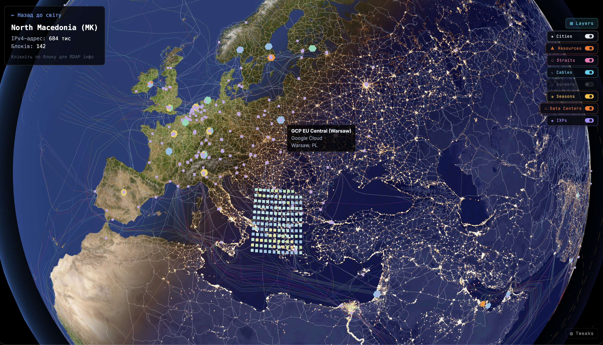

# ipmap

IPv4 allocation globe built with Next.js and Three.js.

ipmap is an interactive 3D visualization of global IPv4 address space allocation based on official RIR delegated statistics, with country-level comparison, block-level drill-down, and on-demand RDAP ownership insights.

## English

ipmap is a 3D globe that visualizes IPv4 address space distribution by country, based on official RIR delegated stats. It is not traffic geolocation.

This project is a fork of sessionmap. The crypto-specific functionality was removed, while the globe core was kept (day/night shaders, atmosphere glow, terminator line, camera, and raycasting).

### Preview



### Three levels of detail

1. World: one marker per country. Marker size and color are proportional to total allocated IPv4 addresses.
2. Country: click a country marker to open a clustered view of its blocks, sorted by starting IP.
3. Block: click a block to load RDAP owner data on demand (organization, handle, allocation date, abuse contact).

RIR data provides country-level allocation, not exact per-block coordinates, so in-country block layout is intentionally synthetic.

### Stack

| Layer        | Technology                                   |
| ------------ | -------------------------------------------- |
| Framework    | Next.js 14 App Router                        |
| Styling      | Tailwind CSS                                 |
| 3D Globe     | Three.js (client-only, no react-three-fiber) |
| State        | React Context + useReducer                   |
| Shared Types | packages/types (TypeScript)                  |
| Monorepo     | pnpm workspaces + Turborepo                  |

Single app architecture: apps/web only. No dedicated backend server. Data is generated by build-time ETL into static JSON files, and RDAP is fetched on demand from the browser.

### Quick start

Prerequisites:

- Node.js >= 20
- pnpm >= 9

Install:

```bash
pnpm install
```

Generate data:

```bash
pnpm build-data
pnpm build-infra-data
```

Run in development:

```bash
pnpm dev
```

If Next.js cache is stale:

```bash
rm -rf apps/web/.next && pnpm dev
```

### Project structure

```text
ipmap/
├── apps/
│   └── web/
├── packages/
│   └── types/
├── scripts/
│   ├── build-ipv4-data.mjs
│   └── build-infra-data.mjs
├── render.yaml
├── turbo.json
└── pnpm-workspace.yaml
```

### Data pipeline

- scripts/build-ipv4-data.mjs downloads delegated files from ripencc, arin, apnic, lacnic, and afrinic.
- It parses allocated/assigned IPv4 rows and aggregates by country.
- Country centroids are sourced from Natural Earth.
- IP ordering and comparisons use BigInt.
- scripts/build-infra-data.mjs builds submarine cable, data center, and IXP layers.

Generated outputs are stored under apps/web/public/data and are gitignored.

### Satellites layer

- Source: CelesTrak GP (OMM JSON), no API key. Groups: `stations` (default), plus `starlink`, `oneweb`, `gps-ops`, `galileo`, `weather` on demand.
- Positions are computed in the browser with SGP4 (satellite.js) inside a Web Worker.
- Server route `/api/satellites?group=...` compresses the OMM data and keeps a 2 h in-memory server cache (shared upstream fetch, stale data served if CelesTrak fails).
- The "Above Kremenets now" list shows satellites over the observer, plus the next visible ISS pass (approximate: the ISS's own illumination is not checked).
- Tweak "Satellites x3 altitude" exaggerates orbit heights for readability.
- GEO satellites (mean motion < 2 rev/day) are not shown in v1.

### Testing

```bash
pnpm --filter @ipmap/web test
pnpm --filter @ipmap/web test:coverage
pnpm type-check
```

### Build and deploy

```bash
pnpm build
```

Deployment target is Render via render.yaml. Build commands generate ETL datasets before next build.

---

## Українська

ipmap це 3D-глобус, який показує розподіл адресного простору IPv4 по країнах на основі офіційних delegated stats від RIR. Це не геолокація трафіку.

Проєкт є форком sessionmap. Крипто-логіку прибрано, а core глобуса залишено (шейдери день/ніч, atmosphere glow, terminator line, камера, raycasting).

### Прев'ю


### Три рівні деталізації

1. Світ: одна точка на країну. Розмір і колір точки пропорційні обсягу IPv4-адрес.
2. Країна: клік по точці відкриває кластер блоків, відсортованих за стартовою IP.
3. Блок: клік по блоку підтягує RDAP-дані власника on demand (організація, handle, дата, abuse контакт).

RIR-дані дають розподіл на рівні країни, а не точні координати блоків усередині країни, тому розклад блоків у межах країни є свідомо штучним.

### Стек

| Рівень       | Технологія                                           |
| ------------ | ---------------------------------------------------- |
| Framework    | Next.js 14 App Router                                |
| Стилі        | Tailwind CSS                                         |
| 3D Globe     | Three.js (тільки client-side, без react-three-fiber) |
| Стан         | React Context + useReducer                           |
| Shared Types | packages/types (TypeScript)                          |
| Monorepo     | pnpm workspaces + Turborepo                          |

Архітектура з одним застосунком: тільки apps/web. Окремого backend-сервера немає. Дані генеруються build-time ETL-скриптами у статичні JSON, RDAP запитується on demand з браузера.

### Швидкий старт

Передумови:

- Node.js >= 20
- pnpm >= 9

Встановлення:

```bash
pnpm install
```

Генерація даних:

```bash
pnpm build-data
pnpm build-infra-data
```

Запуск у development:

```bash
pnpm dev
```

Якщо кеш Next.js застарів:

```bash
rm -rf apps/web/.next && pnpm dev
```

### Структура проєкту

```text
ipmap/
├── apps/
│   └── web/
├── packages/
│   └── types/
├── scripts/
│   ├── build-ipv4-data.mjs
│   └── build-infra-data.mjs
├── render.yaml
├── turbo.json
└── pnpm-workspace.yaml
```

### ETL pipeline

- scripts/build-ipv4-data.mjs завантажує delegated-файли ripencc, arin, apnic, lacnic, afrinic.
- Парсить рядки IPv4 зі статусами allocated/assigned і агрегує по країнах.
- Центроїди країн беруться з Natural Earth.
- Порівняння і сортування IP робиться через BigInt.
- scripts/build-infra-data.mjs будує шари підводних кабелів, дата-центрів та IXP.

Згенеровані файли зберігаються у apps/web/public/data і не комітяться в git.

### Шар супутників

- Джерело: CelesTrak GP (OMM JSON), без API-ключа. Групи: `stations` (за замовчуванням), а також `starlink`, `oneweb`, `gps-ops`, `galileo`, `weather` на вимогу.
- Позиції рахуються у браузері через SGP4 (satellite.js) у Web Worker.
- Серверний роут `/api/satellites?group=...` стискає OMM-дані й тримає серверний кеш у пам'яті на 2 год (спільний запит до апстріму, за збою CelesTrak віддає застарілі дані).
- Список «Над Кременцем зараз» показує супутники над спостерігачем і наступний видимий прольот МКС (наближено: власне освітлення МКС не перевіряється).
- Тюнінг «Satellites ×3 altitude» збільшує висоту орбіт для наочності.
- GEO-супутники (середній рух < 2 об/добу) у v1 не показуються.

### Тести

```bash
pnpm --filter @ipmap/web test
pnpm --filter @ipmap/web test:coverage
pnpm type-check
```

### Збірка і деплой

```bash
pnpm build
```

Деплой на Render через render.yaml. Build-команди генерують ETL-дані перед next build.
